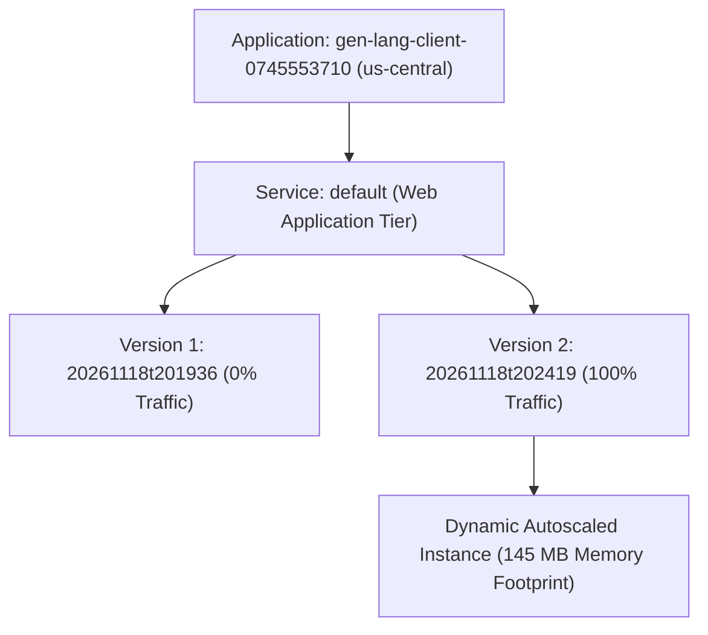

<!-- markdownlint-disable -->

<div align="center">

# ☁️ Experiment 8: Implementing Applications using Google App Engine (PaaS)


[](https://adamasuniversity.ac.in/)
[](https://cloud.google.com/appengine)
[](https://www.python.org/)
[](https://flask.palletsprojects.com/)
[](https://gunicorn.org/)
[](https://cloud.google.com/sdk)
[](Experiment_8.pdf)
[](../README.md)

</div>

---

## 🎯 1. Objective

To explore, implement, and evaluate the **Platform as a Service (PaaS)** cloud computing paradigm using **Google App Engine (GAE)** on **Google Cloud Platform (GCP)**. The laboratory demonstrates the complete lifecycle of cloud-native development: creating a Python Flask web application, pre-deployment validation in Google Cloud Shell on port 8080, packaging declarative `app.yaml` runtime descriptors, deploying to App Engine Standard Environment (`python312`), managing progressive releases and multi-version traffic allocation, tailing live streaming telemetry logs, and monitoring real-time load, request metrics, and automatic horizontal scaling.

---

## 🏗️ 2. Architectural Hierarchy

Google App Engine abstracts away virtual machine management, hypervisor patching, and load balancer provisioning through a four-tier hierarchical operational model:



---

## 🛠️ 3. Step-by-Step Implementation

### Step 3.1 — Cloud Shell Workspace Setup & File Creation
Open Google Cloud Shell and create an isolated working directory `cloud-lab8`:
```bash
mkdir cloud-lab8 && cd cloud-lab8
```

1. **Create the Flask Controller (`main.py`)**:
   ```python
   from flask import Flask

   app = Flask(__name__)

   @app.route("/")
   def home():
       return """
       <h1>Cloud Computing Lab 8</h1>
       <p>Application successfully implemented using Google App Engine.</p>
       <p>This application demonstrates Platform as a Service (PaaS).</p>
       """

   if __name__ == "__main__":
       app.run(host="127.0.0.1", port=8080)
   ```

2. **Create the Dependency Manifest (`requirements.txt`)**:
   ```text
   Flask
   gunicorn
   ```

3. **Create the Deployment Descriptor (`app.yaml`)**:
   ```yaml
   runtime: python312
   ```

### Step 3.2 — Local Verification via Web Preview
Install the local dependencies and run the development server:
```bash
pip install Flask && python main.py
```
Open **Web Preview** on port `8080` in Cloud Shell (`https://8080-cs-905738656321-default.cs-asia-southeast1-fork.cloudshell.dev`) to verify that the local HTTP endpoints respond with HTTP 200.

### Step 3.3 — Live App Engine Deployment (Version 1)
Deploy the application to the App Engine Standard Environment:
```bash
gcloud app deploy
```
- **Target Project:** `gen-lang-client-0745553710`
- **Target Service:** `default`
- **Target Version:** `20261118t201936`
- **Production URL:** [https://gen-lang-client-0745553710.uc.r.appspot.com](https://gen-lang-client-0745553710.uc.r.appspot.com)

### Step 3.4 — Real-Time Log Streaming & Observability
Stream live application logs, Gunicorn WSGI startup events, and incoming HTTP requests:
```bash
gcloud app logs tail -s default
```
```text
[INFO] Starting gunicorn 27.0.1
[INFO] Listening at: http://0.0.0.0:8081 (14)
[INFO] Using worker: sync
[INFO] Booting worker with pid: 15
GET 200 137 B https://gen-lang-client-0745553710.uc.r.appspot.com/
```

### Step 3.5 — Progressive Delivery & Multi-Version Rollout (Version 2)
Update `main.py` with updated styling for Version 2:
```python
cat << 'EOF' > main.py
from flask import Flask

app = Flask(__name__)

@app.route("/")
def home():
    return """
    <h2>Welcome to Cloud Computing Lab 8</h2>
    <h3>Application Version 2</h3>
    <p>Successfully deployed using Google App Engine.</p>
    """

if __name__ == "__main__":
    app.run(host="127.0.0.1", port=8080)
EOF
```
Redeploy the application:
```bash
gcloud app deploy
```
App Engine deploys version `20261118t202419` and shifts 100% of live production traffic with zero downtime, maintaining version `20261118t201936` for instant rollback.

---

## 📊 4. Cloud Monitoring & Telemetry

| Metric / Parameter | Value Observed | Cloud Console Location |
| :--- | :--- | :--- |
| **Project Workspace** | `gen-lang-client-0745553710` | App Engine Header |
| **Deployment Region** | `us-central` | App Engine Dashboard |
| **Traffic Throughput** | `0.0833 requests / second` | Real-time traffic graph |
| **Total Requests (24h)** | `7 requests` | Current Load Table |
| **Average Latency** | `551 ms` | Current Load Table |
| **Active Service** | `default` (Ingress: All) | Services Overview |
| **Active Versions** | `2` (`20261118t202419` 100%, `20261118t201936` 0%) | Versions Management |
| **Dynamic Instances** | `1` autoscaled (`145 MB` memory footprint) | Instances Dashboard |

---

## 📑 5. Lab Report & Documentation

The comprehensive formal laboratory report has been compiled and styled in accordance with academic standards:
- **Formal PDF Report:** [📄 Experiment_8.pdf](Experiment_8.pdf) *(12 pages, Comic Sans MS typography, 12 embedded visual figures, command tables, and service comparison matrices)*

---

<div align="center">

[⬅️ Back to Main Repository](../README.md)

</div>
