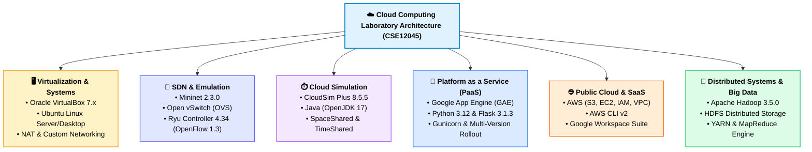

<!-- markdownlint-disable -->

# 💻 Cloud Computing Laboratory (CSE12045) 💻

%20%E2%80%A2%207th%20Semester%20%E2%80%A2%20B.Tech%20CSE&descAlignY=58)

[;%F0%9F%8E%93+ADAMAS+University+%E2%80%A2+Department+of+CSE;%F0%9F%91%A9%E2%80%8D%F0%9F%8F%AB+Under+the+Guidance+of+Prof.+Anusuya+Bera+Ma'am;%F0%9F%91%A8%E2%80%8D%F0%9F%92%BB+Performed+by+Babin+Bid+(UG%2F02%2FBTCSE%2F2023%2F114))](https://git.io/typing-svg)

[-10b981?style=flat-square)](https://adamasuniversity.ac.in/)

---

## 🧑‍💻 Academic & Student Credentials 🧑‍💻

| Academic Attribute | Details / Credentials |
| :--- | :--- |
| 🧑‍🎓 **Student Name** | **Babin Bid** |
| 🔢 **University Roll Number** | `UG/02/BTCSE/2023/114` |
| 🆔 **Registration Number** | `AU/2023/0009748` |
| 🏷️ **Academic Section & Stream** | **Section B** \| **B.Tech CSE (Core)** |
| 📖 **Course Code & Title** | **Cloud Computing Lab (`CSE12045`)** • **7th Semester** |
| 👩‍🏫 **Course Instructor** | **Prof. Anusuya Bera Ma'am** (Dept. of CSE) |
| 🏛️ **Institution** | **ADAMAS University**, Kolkata |

---

## 🛠️ Official Verified Technology Stack 🛠️

| Category | Primary Technologies & Frameworks | Official Verified Badges |
| :--- | :--- | :--- |
| **Virtualization & OS** | Oracle VirtualBox, Ubuntu Linux Server/Desktop, Linux Terminal |     |
| **Networking & SDN** | Mininet Network Emulator, Open vSwitch, Ryu SDN Controller, OpenFlow |     |
| **Cloud Simulation** | CloudSim Plus Toolkit, Java OpenJDK, Apache Maven |    |
| **Public Cloud (IaaS)** | Amazon Web Services (S3, EC2, IAM, VPC, CloudWatch), AWS CLI |       |
| **Public Cloud (PaaS)** | Google App Engine, Google Cloud Platform, Cloud Shell SDK |    |
| **Collaborative Cloud (SaaS)** | Google Drive, Google Docs, Google Sheets, Google Slides |      |
| **Web & App Runtime** | Python 3, Flask Micro-Framework, Gunicorn WSGI, uv Package Tool |     |
| **Big Data & Distributed Computing** | Apache Hadoop, Hadoop Distributed File System (HDFS), YARN, MapReduce |     |

---

## 📚 Curriculum Experiments & Documentation Index

Each laboratory experiment contains a comprehensive, standalone README guide and its corresponding peer-reviewed PDF report with screenshots and execution traces:

| Exp # | Experiment Title | Primary Tools & Stack | Dedicated Guide | PDF Report |
| :---: | :--- | :--- | :---: | :---: |
| **01** | **Installation of Hypervisors and Initiation of VMs** | Oracle VirtualBox, Ubuntu Live Server ISO, GCC, Linux Kernel Headers | [📘 View Guide](Lab_1/README.md) | [📄 Experiment_1.pdf](Lab_1/Experiment_1.pdf) |
| **02** | **Creation and Network Configuration of Virtual Machines** | VirtualBox Full Clone, Custom NAT Network (`Dummy`), ICMP Ping | [📘 View Guide](Lab_2/README.md) | [📄 Experiment_2.pdf](Lab_2/Experiment_2.pdf) |
| **03** | **Installation and Basic Operation of Mininet** | Mininet 2.3.0, Open vSwitch, Single (`single,3`) & Hierarchical Tree (`tree,3`) Topologies | [📘 View Guide](Lab_3/README.md) | [📄 Experiment_3.pdf](Lab_3/Experiment_3.pdf) |
| **04** | **Software-Defined Networking (SDN) with Ryu Controller & Mininet** | Mininet, Open vSwitch (OVS), Ryu 4.34, OpenFlow 1.3, `uv`, Python 3.9 | [📘 View Guide](Lab_4/README.md) | [📄 Experiment_4.pdf](Lab_4/Experiment_4.pdf) |
| **05** | **Implementation of Various Scheduling Mechanisms** | CloudSim Plus 8.5.5, Java 17, Apache Maven, SpaceShared & TimeShared Policies | [📘 View Guide](Lab_5/README.md) | [📄 Experiment_5.pdf](Lab_5/Experiment_5.pdf) |
| **06** | **Familiarization and Usage of Cloud Services Using AWS** | Amazon Web Services (S3, IAM, EC2, VPC, CloudWatch), Ubuntu Linux, AWS CLI v2 | [📘 View Guide](Lab_6/README.md) | [📄 Experiment_6.pdf](Lab_6/Experiment_6.pdf) |
| **07** | **Familiarization and Usage of Collaborative Applications (SaaS)** | Google Workspace (Google Drive, Docs, Sheets, Slides), Multi-User Collaboration | [📘 View Guide](Lab_7/README.md) | [📄 Experiment_7.pdf](Lab_7/Experiment_7.pdf) |
| **08** | **Implementing Applications using Google App Engine (PaaS)** | Google App Engine, Python 3.12, Flask, Gunicorn, Cloud Shell, Traffic Splitting | [📘 View Guide](Lab_8/README.md) | [📄 Experiment_8.pdf](Lab_8/Experiment_8.pdf) |
| **09** | **Develop MapReduce Application Using Hadoop Cluster Setup** | Apache Hadoop 3.5.0, HDFS, YARN, OpenJDK 17, Passwordless SSH, WordCount | [📘 View Guide](Lab_9/README.md) | [📄 Experiment_9.pdf](Lab_9/Experiment_9.pdf) |

---

## 🛠️ Technology & Infrastructure Overview

---

## 📜 Academic Notice & Coursework Disclaimer

This repository and its laboratory documentation are developed and maintained by **Babin Bid** (Roll No: `UG/02/BTCSE/2023/114`, Reg No: `AU/2023/0009748`) for academic coursework and continuous laboratory evaluation in the **Cloud Computing Lab (CSE12045)** under the Department of Computer Science & Engineering, School of Engineering & Technology, **ADAMAS University**, supervised by **Prof. Anusuya Bera**.

The code, configuration scripts, and documentation provided herein are intended strictly for educational, experimental, and research purposes.

✨ Licensed under the [MIT License](LICENSE).

---

*Maintained by **Babin Bid** • ADAMAS University, Kolkata*

